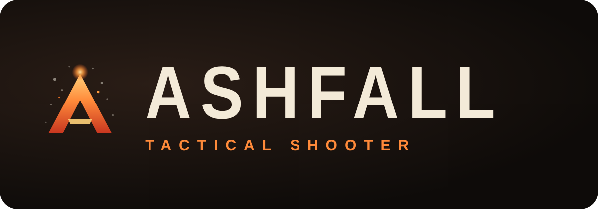

# Dustline

**A free tactical arena shooter you play in your browser. No download, no account, no app store.**

## ▶️ [PLAY NOW — latest version (v54)](https://gaayyynesss.github.io/Seige/?v=54)

**Latest:** https://gaayyynesss.github.io/Seige/?v=54

If the game looks like an older version, open the latest link above (the `?v=` number makes your browser load the newest copy).

### Version history
| Version | Link | What's new |
|---|---|---|
| **v54** | https://gaayyynesss.github.io/Seige/?v=54 | **Weapon levels up to 100** with 4 new mastery camos (Platinum lv 25, Obsidian Flame lv 50, Damascus lv 75, Dark Matter lv 100), and you can now **climb onto crates, sandbags and low walls** (tap JUMP next to them) and stand, walk and jump on top |
| v53 | https://gaayyynesss.github.io/Seige/?v=53 | **Aim assist slider** (0–100% strength in Settings) and a **UI remake**: tabs with icons, glassy rounded cards, accent headers and focus glow on the menus; rounded health/ammo cards, glowing minimap ring and glass touch buttons in matches |
| v52 | https://gaayyynesss.github.io/Seige/?v=52 | **Realistic guns:** all 12 guns rebuilt with real shapes (angled grips, shaped stocks, curved/straight/drum mags, round barrels with muzzle brakes, vented rails, holo sights, bolt handle, revolver cylinder, pump shotgun). **Real bullets:** glowing rounds in flight, brass shell casings that eject and bounce, and bullet holes where shots hit |
| v51 | https://gaayyynesss.github.io/Seige/?v=51 | **Sound & music:** menu music (fades out in matches, own volume slider), every gun has its own sound, footsteps change with the ground (snow, sand, hard ground), and a kill-confirm sound |
| v50 | https://gaayyynesss.github.io/Seige/?v=50 | **Stats card** on the Career tab (rank, K/D, win rate, best weapon, favorite map and more) and a **friends list**: add friends by callsign and see when they're online and what they're playing |
| v49 | https://gaayyynesss.github.io/Seige/?v=49 | **Ranked mode:** ranked Team Battle with rank points and 5 ranks (Bronze → Silver → Gold → Platinum → Diamond), a rank card on the Play tab, rank badges on the scoreboard, and bots that get tougher as you climb |
| v48 | https://gaayyynesss.github.io/Seige/?v=48 | Battle pass tiers now take **599 XP** each from Season 2 on (was 650). XP you already earned this season counts toward the new tiers |
| v47 | https://gaayyynesss.github.io/Seige/?v=47 | Fix: on iPad a black strip could appear at the bottom after scrolling the menu; the game now re-checks the screen size twice a second and fixes itself. The menu also no longer runs slightly off the bottom of the screen |
| v46 | https://gaayyynesss.github.io/Seige/?v=46 | **Adaptive bots:** they get easier when you're struggling and tougher when you're doing really well. New **Bot difficulty** setting (Adaptive, Easy, Normal, Hard) |
| v45 | https://gaayyynesss.github.io/Seige/?v=45 | **Season 2: Harvest is live** (Nov 16–26): orange colors, pumpkins and hay bales on every map, 75 tiers at **650 XP per tier**. **Season 2 Premium code: `SCYTHE26`** (the old code `DUSTVIP` no longer works). Reach tier 75 with Premium for the **SC-7 Scythe** |
| v44 | https://gaayyynesss.github.io/Seige/?v=44 | **Kill cam** (watch from behind whoever got you while you wait to respawn) and a **Match MVP** card at the end of every match (+100 coins if it's you) |
| v43 | https://gaayyynesss.github.io/Seige/?v=43 | Two new maps: **Hollow Pines** (snowy village at night, wooden cabins, lamp posts, falling snow) and **Greywater** (rainy harbor with a warehouse, stacked containers, dock cranes and rain). Also fixed the gun floating in the menu background |
| v42 | https://gaayyynesss.github.io/Seige/?v=42 | **Weapon attachments** unlocked by gun level: Extended Mag (lv 2), Grip (lv 4), Laser (lv 6), Suppressor (lv 8); up to 2 per gun |
| v41 | https://gaayyynesss.github.io/Seige/?v=41 | Slightly smarter bots: they notice you a bit faster, check where they last saw you, back off and strafe when hurt, roam the whole bigger map, and aim a touch better at range |
| v40 | https://gaayyynesss.github.io/Seige/?v=40 | **Kill streak buttons** (use Map Scan / Missile when you want), **perks & wildcards** (Salvager supply drops and 8 more perks, 4 wildcards), **14 new crate items**, a **refreshed UI**, and **much bigger maps** (140 m across, with buildings to fight through) |
| v39 | https://gaayyynesss.github.io/Seige/?v=39 | **Grenades** (2 per life, NADE button or G), new **Gun Game** mode (free-for-all vs bots, a new gun every elimination), and **17 achievements** with coin rewards on the Career tab |
| v38 | https://gaayyynesss.github.io/Seige/?v=38 | Fix: on iPad the bottom buttons (Fire, Aim, Crouch, Reload) could be cut off when the browser toolbar changed size; the game now always fits the visible screen |
| v37 | https://gaayyynesss.github.io/Seige/?v=37 | Fix: on iPad the top of the screen (health, score bar, minimap) could get cut off after typing or swiping; the game now snaps back into place |
| v36 | https://gaayyynesss.github.io/Seige/?v=36 | **Better camos:** every camo on the gun now uses exactly the colors on its swatch, with real patterns (tiger stripes, digital pixels, carbon weave, galaxy stars, lava cracks, diamond facets); new richer colors for Dune, Jungle, Frost, Blood, Cobalt and Gold |
| v35 | https://gaayyynesss.github.io/Seige/?v=35 | **Blackjack table** in the Shop (game coins only), **new detailed soldiers** (knees, shaped arms, gear, smoother animation), **Ultra graphics** setting, and a 60 FPS guard on every graphics level |
| v32 | https://gaayyynesss.github.io/Seige/?v=32 | Back to 1,000 XP per tier; Season 1 runs until Nov 19 and weekly seasons start Nov 20; Season 2 Premium code **`SCYTHE26`** (works from Nov 20) and the **SC-7 Scythe** premium SMG |
| v31 | https://gaayyynesss.github.io/Seige/?v=31 | Battle pass tiers now take 400 XP each (was 1,000) |
| v30 | https://gaayyynesss.github.io/Seige/?v=30 | **Weekly seasons** (75 tiers, new colors + map decorations each week, Christmas season), **daily rewards & challenges**, **kill streaks** (Map Scan at 10, Missile at 30), match coin bonuses, Team Battle to 100, bigger maps, shop daily item and bad-luck protection |
| v29 | https://gaayyynesss.github.io/Seige/?v=29 | Crate prices 320 / 750, new 1,000-coin **Vault Crate** (Phantom skin + Aurora camo), and a **?** on each crate showing its odds and items |
| v28 | https://gaayyynesss.github.io/Seige/?v=28 | Sliding no longer leaves you crouched — you stand back up when the slide ends |
| v27 | https://gaayyynesss.github.io/Seige/?v=27 | Map vote between matches is now 5 seconds (was 12) |
| v26 | https://gaayyynesss.github.io/Seige/?v=26 | Shop tab always visible (tab row wraps instead of scrolling off-screen) |
| v25 | https://gaayyynesss.github.io/Seige/?v=25 | Coins (10 per elimination) and the **Shop** with Field and Elite crates |
| v24 | https://gaayyynesss.github.io/Seige/?v=24 | Tier 50 on the Pass tab shows the VX-9 Tempest |
| v23 | https://gaayyynesss.github.io/Seige/?v=23 | VX-9 Tempest custom rifle for finishing the Premium pass |
| v22 | https://gaayyynesss.github.io/Seige/?v=22 | Match leaderboard and personal leaderboards |
| v21 | https://gaayyynesss.github.io/Seige/?v=21 | B60 LMG buff |
| v20 | https://gaayyynesss.github.io/Seige/?v=20 | Weapon levels, per-gun camos, tap-to-toggle aim |

---

## How to join
1. Open the link above on a phone, tablet or computer.
2. Type a callsign on the **Play** tab.
3. Tap **Team Battle** to join the online match, or **Drone Holdout** to play solo.

Everyone who opens the link plays in the same Team Battle. AI soldiers fill every empty slot, so a match always has 5 players on each team.

**iPhone and iPad:** open the link in Safari, tap **Share**, then **Add to Home Screen**. It opens full-screen like an app. Turn the device sideways to play.

**Private match:** type the same **private battle code** on the Play tab as your friends, for example `squad1`. Only players using that code join your match.

**Party:** on the Play tab tap **Create party** to get a short code, and send it to a friend. They type it in and tap **Join**. Party members fight each other in **Duel 1v1** and play on the **same team** in Team Battle.

**Keep your progress:** your callsign, career, battle pass and skins save on your device automatically. To move them to another phone or computer, open the **Career** tab, tap **Show backup code**, copy it, and paste it into **Restore from code** on the other device.

## Game modes
| Mode | Description |
|---|---|
| **Team Battle** | Delta vs Viper, 5 v 5, across seven maps (Outpost, Dockyard, Frostline, Refinery, Hollow Pines, Greywater, Blacksite). The first team to 100 eliminations wins. Party members play on the same team. |
| **Ranked** | Ranked Team Battle (5 v 5, first to 100). Win: **+25 RP** plus 1 per elimination (up to +10). Loss: **−15 RP** (a little back for 5+ eliminations). Quitting mid-match counts as a loss (−20). Ranks: 🥉 Bronze (0), 🥈 Silver (300), 🥇 Gold (700), 💠 Platinum (1,200), 💎 Diamond (1,800). Bots get tougher at higher ranks. Your rank badge shows next to your name on the scoreboard. |
| **Duel 1v1** | Face your party member one on one, no bots, first to 7 eliminations. Make a party and share the code first. |
| **Gun Game** | Free-for-all against 9 bots. Every elimination swaps you to the next of 10 guns (SMG → PDW → Rifle → Battle Rifle → LMG → Shotgun → Marksman → Sniper → Hand Cannon → Sidearm). First to get an elimination with all 10 wins. Grenades are off in this mode. |
| **Drone Holdout** | Solo survival against endless waves of armed drones. Grab green supply cases to heal. |

## Daily rewards & challenges
The **Daily** box on the Play tab has:
- **Login reward:** tap **Claim** once a day. Coming back on days in a row pays more: 50, 75, 100, 150, 200, 250, then 300 coins every day after that. Miss a day and it starts over.
- **3 daily challenges:** two give battle-pass XP (1,500–3,000 XP) and one gives coins (250–300). They change every day at midnight.

## Grenades
You carry **2 frag grenades** each life. Tap **NADE** (or press **G**) to throw one. It bounces off walls and the ground and explodes after 2 seconds, hurting enemies within about 7 meters who aren't behind cover. In Drone Holdout you get one more grenade (up to 3) after every wave.

## Achievements
The **Career** tab lists 17 achievements, such as First Blood, Centurion (100 eliminations), Scanner (10 streak), Missile Man (30 streak), Gun Master (win a Gun Game), Lucky (own a Legendary) and Collector (own every crate item). Each pays coins once, from 50 up to 2,000.

## Kill streaks
Eliminations in a row without dying:
| Streak | Reward |
|---|---|
| **10** | **Map Scan:** every enemy shows on your minimap for 15 seconds |
| **30** | **Missile Strike:** a missile hits the biggest group of enemies |

Your current streak shows in the top-right corner during a match. When you earn a reward, a glowing **SCAN** or **MISSILE** button appears on the left side of the screen. Use it whenever you want (keyboard: **Z** for Map Scan, **X** for Missile). Earned rewards stay until you use them, even if you die, and reset at the start of the next match.

## Attachments
Each gun unlocks attachments as it levels up. Pick up to 2 per gun on the **Loadout** tab (the list shows the gun you have selected).

| Attachment | Gun level | What it does |
|---|---|---|
| **Extended Mag** | 2 | +30% magazine size |
| **Grip** | 4 | 25% less recoil |
| **Laser** | 6 | 25% tighter hip-fire spread |
| **Suppressor** | 8 | No muzzle flash, and bots take longer to react to you |

## Perks & wildcards
On the **Loadout** tab pick one perk in each of three slots, plus a wildcard.

| Slot | Perk | What it does |
|---|---|---|
| Perk 1 | **Salvager** | Enemies you eliminate drop a supply box. Walk over it to refill your magazine and get a grenade. |
| Perk 1 | **Tough Skin** | Health comes back after 3 seconds instead of 5, and faster. |
| Perk 1 | **Quickdraw** | Aim down sights 40% faster. |
| Perk 2 | **Fleetfoot** | Move 8% faster and sprint longer. |
| Perk 2 | **Fast Hands** | Reload 25% faster. |
| Perk 2 | **Steady Aim** | 30% tighter hip-fire spread. |
| Perk 3 | **Tracker** | Enemies you hit show on your minimap for 4 seconds. |
| Perk 3 | **Hardline** | Map Scan at 8 eliminations, Missile at 27. |
| Perk 3 | **Demolitions** | +1 grenade every life and a bigger blast. |

| Wildcard | What it does |
|---|---|
| **Perk Hoarder** | 2 perks in every slot (6 perks). |
| **Rule Breaker** | Pick any 3 perks from any slot. |
| **Deep Pockets** | 50% bigger magazines on every gun. |
| **Demo Expert** | +2 grenades every life. |

## Coins & shop
You earn **10 coins** for every elimination in Team Battle, Duels and Drone Holdout, **+5** for a headshot elimination, and a **+50** bonus for winning a match. The coins you earned show at the end of each match. Spend them on the **Shop** tab:

| Crate | Price | Common | Rare | Epic | Legendary |
|---|---|---|---|---|---|
| Field Crate | 320 coins | 55% | 28% | 13% | 4% |
| Elite Crate | 750 coins | 20% | 40% | 28% | 12% |
| Vault Crate | 1,000 coins | — | 25% | 45% | 30% |

Crates hold shop-only operator skins (Sand Viper, Copperhead, Midnight, Royal Guard, Night Raid, Tundra Wolf, Neon Runner, Hazmat, Specter, Magma, Inferno King) and camos that work on every gun (Olive Drab, Rust, Autumn, Urban Grid, Zebra, Bubblegum, Ocean, Toxic Waste, Neon, Galaxy, Ruby, Nebula, Lava, Molten Gold). The **Vault Crate** has no commons and is the only crate with the legendary **Phantom** and **Voidwalker** skins and the **Aurora** camo. Tap the **?** on any crate to see its odds and every item inside with its exact drop chance. A duplicate refunds coins (Common 50, Rare 100, Epic 200, Legendary 400).

- **Bad-luck protection:** if you open 9 crates of the same type without a Legendary, the 10th is a guaranteed Legendary. Each crate shows how many are left.
- **Daily item:** one crate item is for sale directly each day (Common 400, Rare 800, Epic 1,300, Legendary 2,000 coins). Everyone sees the same item. Your coins and crate items are saved on your device and in your backup code.

## Seasons
> **Current Premium code (Season 2): `SCYTHE26`**. Enter it on the **Pass** tab.

**Season 2** runs Nov 16–26. From **Season 3 (Nov 27)** a **new season starts every week** (Fridays). Each season has its own **color scheme**, **map decorations**, and a new season camo at tier 60. Everything you unlocked in earlier seasons stays yours.

| Season | Dates (2026) | Theme | Premium code | Premium weapon |
|---|---|---|---|---|
| 1 | until Nov 15 | Dust Storm (50 tiers) | `DUSTVIP` | VX-9 Tempest rifle |
| 2 | **Nov 16–26 (live now)** | Harvest: pumpkins and hay bales | **`SCYTHE26`** | SC-7 Scythe SMG |
| 3 | Nov 27–Dec 3 | Neon Grid: glowing neon posts | added the day before | added the day before |
| 4 | Dec 4–10 | Frostbite: ice crystals and snowfall | added the day before | added the day before |
| 5 | Dec 11–17 | Midnight: floating violet orbs | added the day before | added the day before |
| 6 | Dec 18–24 | **Christmas:** snow on every map, decorated trees with presents, snowmen, candy canes | added the day before | added the day before |
| 7 | Dec 25–31 | **Christmas & New Year:** Christmas decorations with gold | added the day before | added the day before |

## Blackjack
The **Shop** tab has a blackjack table that uses **game coins only** (never real money). Bet 10–250 coins, then **Hit**, **Stand** or **Double**. Blackjack pays 3:2, the dealer stands on 17, and a tie (push) gives your bet back.

## Battle pass & skins
Each season has a free battle pass with Season 1 had 50 tiers of **1,000 XP**, and every season from Season 2 has **75 tiers of 599 XP**, with coins every 5 tiers. Earn XP by getting eliminations, finishing and winning matches, and surviving Holdout waves. Ranking up unlocks **weapon camos** and **titles**. All **operator skins are free** to equip from the start on the **Loadout** tab; titles are equipped there too. Progress is saved on your device and travels with your backup code.

### Premium pass
An optional **Premium Pass** unlocks 3 exclusive operator skins (Gold Rush, Obsidian, Prism), the **VIP** title, and **+25% XP**. **Each season has its own Premium code and its own premium weapon**, earned by reaching the season's final tier with Premium: the **VX-9 Tempest** rifle in Season 1 and the **SC-7 Scythe** SMG in Season 2. Skins, the VIP title and weapons you earn stay yours after the season ends. Enter the code on the **Pass** tab. (The codes are set by the game's creator in `PREMIUM_CODES` in index.html.)

## Loadouts
| Weapon | Type | Best for |
|---|---|---|
| **M7 Rifle** | Assault rifle | All-round fighting at any range |
| **K9 SMG** | Submachine gun | Fast, close-quarters fights |
| **H12 Breacher** | Shotgun | Point-blank power indoors |
| **B60 LMG** | Light machine gun | Suppressing fire, big magazine |
| **R4 Marksman** | Marksman rifle | Long-range picks with a scope |
| **Kestrel .338** | Sniper rifle | One-shot kills at distance |

Plus a sidearm, a battle rifle, a compact PDW and a hand cannon.

**Weapon levels:** every gun levels up (**1–100**) from its own eliminations (level 10 = 110 eliminations, level 50 = 1,878, level 100 = 6,788). Leveling a gun unlocks **Tiger (3), Digital (5), Carbon (7), Dragon (9), Diamond (10), Platinum (25), Obsidian Flame (50), Damascus (75) and Dark Matter (100)** camos for that gun, and each gun remembers its own camo. Each weapon has its own scope or red-dot sight when you aim down the sights.

Headshots deal about double damage and leg hits deal less. Damage drops off at long range.

## Controls
| Action | Touch | Keyboard + mouse |
|---|---|---|
| Move | Left thumb (push to the edge to sprint) | W A S D (Shift to sprint) |
| Aim | Right thumb | Mouse |
| Shoot | Hold **FIRE** (slide to aim while shooting) | Left click |
| Aim down sights | Tap **AIM** (tap again to stop; drag from it to look) | Right click |
| Crouch | **CROUCH** | C |
| Jump / climb | **JUMP** (next to a crate, sandbags or a low wall it climbs you on top; thin cover is vaulted over) | Space |
| Reload | **RELOAD** | R |
| Throw grenade | **NADE** | G |
| Use Map Scan / Missile | **SCAN** / **MISSILE** (appear when earned) | Z / X |
| Leaderboard | Tap the score bar | Hold Tab |
| Pause | **II** | Esc |

## Profile & friends
The **Career** tab opens with your **stats card**: rank badge, RP, eliminations, K/D, wins and win rate, best weapon (most eliminations), favorite map (most matches), best streak, best Holdout wave, season tier and achievements.

Below it is your **friends list**. Type a friend's exact callsign and tap **Add**. A green dot means they're online, and it shows what they're doing (menu, Team Battle, Ranked, Gun Game or Holdout) with their rank badge. The top of the menu also says how many friends are online. To play together, make a party on the Play tab and send them the code.

## Kill cam & MVP
- **Kill cam:** when you're eliminated in Team Battle, Duels or Gun Game, the camera shows the player who got you, from just behind them, until you respawn.
- **Match MVP:** at the end of every match a card shows the top player with their eliminations, deaths and K/D. If it's you, you get **+100 coins**.

## Leaderboards
- **Match leaderboard:** tap the score bar at the top (or hold **Tab** on a keyboard) to see every player and bot ranked by eliminations and deaths. It also shows at the end of every match and on the pause screen.
- **Your leaderboards:** the **Career** tab lists your 10 best battles and your 10 best Drone Holdout runs. They save on your device and travel with your backup code.

## Bot difficulty
Bots are **Adaptive** by default. The game watches your recent eliminations and deaths: if you're struggling, bots aim worse, react slower and pause longer between bursts; if you're doing really well, they get sharper (up to a fair limit). It changes gradually and remembers your level between matches. You can also pick **Easy**, **Normal** or **Hard** in **Settings**, which shows the current adaptive level.

## Sound & music
- **Menu music:** a calm synth track plays on the menus (it starts after your first tap) and fades out when a match starts. Change its volume with **Menu music** in Settings.
- **Gun sounds:** each gun has its own sound on top of its weapon type, for example a deep thump on the LMG, a heavy boom on the Hand Cannon, an electric zap on the VX-9 and a copper zing on the SC-7.
- **Footsteps:** they sound different on snow (crunch), sand (soft) and hard ground (sharp taps).
- **Kill confirm:** a short ding when you get an elimination.

## Settings
Open the **Settings** tab to change look and aiming sensitivity, **aim assist strength** (0% = off up to 100%), graphics quality (**Low, Medium, High or Ultra**; every level holds 60 FPS by lowering resolution and then shadow detail only when needed), aim assist, auto-fire, the left-handed touch layout, field of view, camera motion, the frame-rate counter, volume, crosshair color and size, and the minimap. Pick **Low** quality if the game feels slow on an older device.

## Notes
- Online play connects players directly to each other. On some strict networks, such as certain school or cellular networks, two players may not be able to connect. When that happens, each player still gets a full match against bots.
- Career stats (wins, eliminations, K/D and best wave) are saved on your own device.
