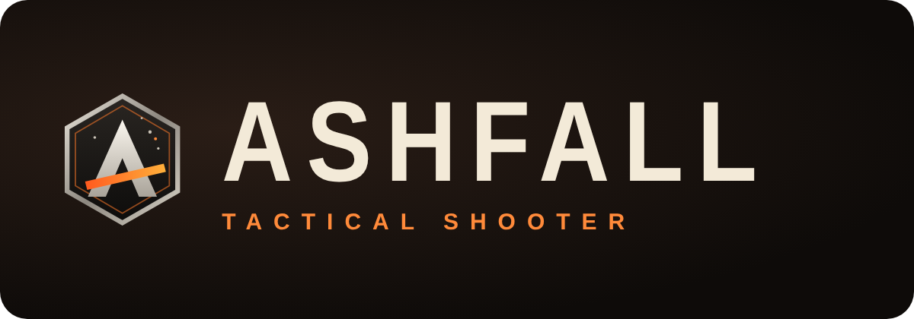
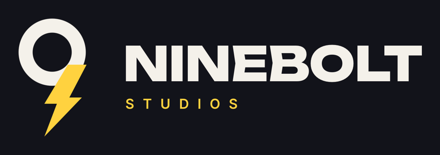

# Ashfall

**A free tactical arena shooter you play in your browser (formerly Dustline). No download, no account, no app store.**

*A Ninebolt Studios game.*

## ▶️ [PLAY NOW — latest version (v105)](https://ninebolt-studios.github.io/Ashfall/?v=105)

**Latest:** https://ninebolt-studios.github.io/Ashfall/?v=105

If the game looks like an older version, open the latest link above (the `?v=` number makes your browser load the newest copy).

### 📲 Get the app (iPhone / iPad)
Open **[Ashfall.mobileconfig](https://ninebolt-studios.github.io/Ashfall/Ashfall.mobileconfig)** in **Safari**, then go to **Settings → Profile Downloaded → Install**. You get an Ashfall icon that opens the game full-screen and always loads the newest version. (School-managed iPads may block profiles; then use Safari's **Share → Add to Home Screen**.)

### Version history
| Version | Link | What's new |
|---|---|---|
| **v105** | https://ninebolt-studios.github.io/Ashfall/?v=105 | **New mode: ⛰️ Hardpoint.** 5v5 with bots: one glowing hill that moves to a new spot every 60 seconds. Your team scores a point every second it holds the hill uncontested (blue = yours, red = enemy, yellow = contested). First to 150 |
| v104 | https://ninebolt-studios.github.io/Ashfall/?v=104 | **New mode: 🏷️ Kill Confirmed.** 5v5 with bots: every elimination drops a glowing dog tag. Grab enemy tags to score (+XP), grab your own team's tags to deny the point. Tags vanish after 30 s. First to 50 |
| v103 | https://ninebolt-studios.github.io/Ashfall/?v=103 | **Spectate in Search & Destroy:** after you're eliminated (and the kill cam ends) you watch a living teammate from behind until the round is over. Tap Fire to switch to another teammate |
| v102 | https://ninebolt-studios.github.io/Ashfall/?v=102 | **🕹️ Custom touch controls:** Settings → Touch controls layout → **Edit layout**. Drag Fire, Aim, Jump, Crouch, Reload, Slide, Grenade, Ping and Chat anywhere on screen and use the Size slider to make each one bigger or smaller. Saved on your device (and in your account); Reset puts them back |
| v101 | https://ninebolt-studios.github.io/Ashfall/?v=101 | **Aim assist nerfed a little:** it's 20% weaker at every slider setting (less slowdown over enemies and less pull), so gunfights rely more on your own aim |
| v100 | https://ninebolt-studios.github.io/Ashfall/?v=100 | **More ranks:** 22 ranks instead of 5. Every rank now has divisions I, II and III, and there are three new top ranks above Diamond: 🔥 **Crimson** (2,500 RP), 🌈 **Iridescent** (3,300 RP) and 👑 **Champion** (4,200 RP). Your RP is unchanged; higher ranks face tougher bots |
| v99 | https://ninebolt-studios.github.io/Ashfall/?v=99 | **🎮 Controller support** (PlayStation, Xbox, Backbone, other MFi controllers): left stick move, right stick aim, RT fire, LT aim down sights, A/✕ jump, B/◯ crouch or slide, X/▢ reload, Y/△ ping, LB grenade, RB kill streak, L3 sprint, D-pad quick chat, Start pause/resume |
| v98 | https://ninebolt-studios.github.io/Ashfall/?v=98 | **Quick chat & pings:** tap 📍 to drop a ping where you aim (red if you're aiming at an enemy), and 💬 for quick messages (Enemy spotted, Need ammo, On my way, Cover me, Nice shot, Thanks, Good game). Teammates in online matches see your pings and messages; bot teammates reply. Keyboard: Z to ping, X then 1-7 to chat |
| v97 | https://ninebolt-studios.github.io/Ashfall/?v=97 | **Friends with accounts:** when you're signed in you get a 6-letter **friend code**. Add friends by their code to see who's online and what they're playing, and tap **Join party** to hop into their party with no codes to type |
| v96 | https://ninebolt-studios.github.io/Ashfall/?v=96 | **Weekly leaderboard:** the 🌍 board on the Career tab now has **All-time** and **This week**. The weekly board resets every Monday and ranks eliminations, wins and XP earned that week, so new players can make the top 25 too |
| v95 | https://ninebolt-studios.github.io/Ashfall/?v=95 | **Player levels & ⭐ Prestige:** a new player level from 1 to 55 built from all the XP you earn (shown next to your name; existing players start at a level based on their career). At level 55, Prestige from the Career tab: level resets to 1 and you get a ★ badge, the "Prestige N" title and ◎ 1,000, up to Prestige 10 |
| v94 | https://ninebolt-studios.github.io/Ashfall/?v=94 | **New: 🎯 Firing Range.** Steel targets at 10, 25, 50 and 80 m plus a target that slides side to side. Every hit shows distance, body or head, and damage; targets drop after 100 damage and pop back up. Tap **Next gun** to try every gun you own, with unlimited ammo |
| v93 | https://ninebolt-studios.github.io/Ashfall/?v=93 | Ashfall now lives under **Ninebolt Studios**: new play link https://ninebolt-studios.github.io/Ashfall/ and repo https://github.com/Ninebolt-Studios/Ashfall. **Sign in to your account** (Career tab) to bring your progress to the new address. The app profile was updated too: reinstall it from Settings → 📲 Get the Ashfall app |
| v92 | https://ninebolt-studios.github.io/Ashfall/?v=92 | **New mode: 💣 Search & Destroy.** 5v5 with bots, one life per round, first to 4 rounds. Attack: carry the bomb and plant it on site A or B (stand in the ring for 3 s). Defend: stop the plant, or defuse the bomb within 40 s (5 s hold). Sides swap every round. Also: the Ninebolt Studios intro now waits for its logo (no more lonely "presents") and fades much sooner |
| v91 | https://ninebolt-studios.github.io/Ashfall/?v=91 | **New mode: 🚩 Domination.** 5v5 with bots on the big maps: capture and hold flags A, B and C (stand in the ring to capture; more teammates capture faster). Every flag you hold scores a point every 1.5 s; first to 150 wins. +100 XP and coins for each capture you're in. Bots fight over the flags |
| v90 | https://ninebolt-studios.github.io/Ashfall/?v=90 | **Ashfall app for iPhone/iPad:** install `Ashfall.mobileconfig` (button in Settings → 📲 Get the Ashfall app, or the link above) to get a full-screen Ashfall icon that always opens the newest version |
| v89 | https://ninebolt-studios.github.io/Ashfall/?v=89 | **More realistic bullets:** tracers are now a thin white-hot core with a soft orange glow that tapers to a tail and flies faster; enemy rounds are thin glowing tracers instead of chunky boxes; bullet holes are chipped craters with cracks that look different on concrete, wood, metal and sand; every impact kicks up a dust puff colored by the surface |
| v88 | https://ninebolt-studios.github.io/Ashfall/?v=88 | **90 bot names** (real surnames and callsigns like Ghost, Viper, Reyes, Novak); every match picks a fresh set, the same for everyone in the lobby. **5v5 maps resized to 165 m** across (from 190 m) so fights find you faster, still bigger than the original 140 m |
| v87 | https://ninebolt-studios.github.io/Ashfall/?v=87 | The repo is now **Ashfall**. New play link: https://ninebolt-studios.github.io/Ashfall/ (all links updated) |
| v86 | https://ninebolt-studios.github.io/Ashfall/?v=86 | The **browser tab icon** and home-screen icon now show the Ashfall badge (they were stuck on the old cached Dustline icon) |
| v85 | https://ninebolt-studios.github.io/Ashfall/?v=85 | The GitHub page banner now shows the new **Ashfall** logo (it was stuck on the old cached Dustline image), and shared links show an Ashfall preview card |
| v84 | https://ninebolt-studios.github.io/Ashfall/?v=84 | **Dustline is now Ashfall!** New military-badge logo (steel hexagon, bold A with a burning slash) on the menu, browser tab and home-screen icon. **Season colors fixed:** every season now changes the whole menu and HUD color scheme (accent plus tinted panels and background), not just the map decorations. Season 2 Harvest is now maple red-orange. Your saves, account and coins are unchanged |
| v83 | https://ninebolt-studios.github.io/Ashfall/?v=83 | **Account fixes:** accounts made on v76 stopped auto-saving after v77 and could ask "which progress to keep?"; that is fixed and they save again. A device with **less** progress than your account can no longer overwrite it by accident (it loads your account instead, or warns you with ⚠️ and asks again). Your account now keeps backups of bigger older saves, with a **Restore older save** button. The choice never pops up in the middle of a match |
| v82 | https://ninebolt-studios.github.io/Ashfall/?v=82 | **Much bigger 5v5 maps:** Team Battle and Ranked arenas are now about 190 m across (was 140 m), with a whole extra outer ring of buildings, containers, crates, sandbags and walls to fight through. Duels, Gun Game, Holdout and Zombies keep their tighter size |
| v81 | https://ninebolt-studios.github.io/Ashfall/?v=81 | **More realistic textures and soldiers:** wooden crates are now weathered planks with real wood grain, knots, gaps, rusty nails and worn edges; concrete walls have fine air pores and aggregate; sandbags are woven burlap with creases; gun metal is cleaner (less speckle). Soldiers have rounded, more natural shapes and fabric-textured uniforms, helmet covers and balaclavas |
| v80 | https://ninebolt-studios.github.io/Ashfall/?v=80 | **CoD-style graphics pass:** soft contact shadows under every crate and wall, film-style color grading and vignette while you play, floating dust in the air, more realistic gun metal and smooth matte polymer (no more speckled "granite" look), and soldiers now carry a chest radio, frag grenade, rifle sling and team shoulder patches |
| v79 | https://ninebolt-studios.github.io/Ashfall/?v=79 | **Louder menu music** (about 2.5x louder, default slider now 70%) with a limiter so it stays clean instead of crackling. You can still change it in Settings → Audio → Menu music |
| v78 | https://ninebolt-studios.github.io/Ashfall/?v=78 | **CoD-style ammo:** you spawn with a full mag plus 3 spare mags (e.g. 30 / 90), and every reload uses up your spare bullets. Enemies you take down drop an ammo box (Salvager drops a full refill + grenade); Zombies gives 5 spare mags and Max Ammo refills everything. **🌍 Global leaderboard** on the Career tab: top 25 players by Eliminations, Wins, Ranked RP and best Zombies wave (sign in to get on it). The Zombies **Mystery Crate** no longer shows up in other modes |
| v77 | https://ninebolt-studios.github.io/Ashfall/?v=77 | The **☁️ Account** box is now at the very top of the Career tab. Fixed a wrong "which progress do you want to keep?" popup that could appear after switching devices |
| v76 | https://ninebolt-studios.github.io/Ashfall/?v=76 | **Accounts!** On the Career tab, create an account with your email and a password and your progress saves online automatically (about every 40 seconds and when you leave). Sign in on any iPad, phone or computer to get everything back. If your account and a device have different progress, the game asks which one to keep. Forgot password sends a reset email. A ☁️ next to your name means you are signed in |
| v75 | https://ninebolt-studios.github.io/Ashfall/?v=75 | **Save files:** on the Career tab tap **💾 Save to file** to keep your whole progress as a file (save it to Files, Notes or send it to yourself), and **📂 Load save file** to get it back on any device. Shows when you last saved. The **Played before?** card on a new device can load a save file too |
| v74 | https://ninebolt-studios.github.io/Ashfall/?v=74 | **Coins and rank reset for everyone**: all players start again at ◎ 0 and Bronze 0 RP (skins, camos, guns and battle pass are kept; old backup codes can't bring back old coins or rank). If you open the game somewhere with no save (another app's browser, a private tab, a new device), a **Played before? Restore** card helps you load your backup code. The game also asks your browser to keep your save so it is less likely to be cleared |
| v73 | https://ninebolt-studios.github.io/Ashfall/?v=73 | Cleaned up the version notes |
| v72 | https://ninebolt-studios.github.io/Ashfall/?v=72 | **Ninebolt Studios** branding: a studio intro screen when the game opens (tap to skip, shows once per visit), "A Ninebolt Studios game" under the Dustline title, and the studio logo in this README |
| v71 | https://ninebolt-studios.github.io/Ashfall/?v=71 | Your rank on the Play tab now updates right away instead of after a reload |
| v70 | https://ninebolt-studios.github.io/Ashfall/?v=70 | New **Codes** box in **Settings** for gift and Premium codes. New one-time code: **`GIFT-L10-C9B12D8E`** gives **+10 battle pass levels** (works once per device) |
| v69 | https://ninebolt-studios.github.io/Ashfall/?v=69 | **Battle pass fix:** your pass level is now backed up in a second save slot, so a glitch can't reset it to tier 1. Players who finished Season 1 at tier 49+ get the VX-9 Tempest even if their old save lost the details. The Pass tab shows what tier you finished last season on. Removed old Season 1 rollback code that could wipe Season 2 progress |
| v68 | https://ninebolt-studios.github.io/Ashfall/?v=68 | **Gift codes** for friends; the old public Tempest gift code no longer works and secret codes are no longer stored in the game in plain text. The Premium code box now stays visible so premium players can redeem gift codes |
| v67 | https://ninebolt-studios.github.io/Ashfall/?v=67 | Season 2 started early, so anyone who finished the **Season 1 pass at tier 49 or higher** now gets the **VX-9 Tempest** (with a one-time notice on the Play tab) |
| v66 | https://ninebolt-studios.github.io/Ashfall/?v=66 | **Calling cards:** unlock 15 banners and 15 emblems with coins (Loadout tab); your card shows when you get someone (KILLED BY) and theirs when you get them (ELIMINATED). **Full-screen MVP moment** at the end of every match with the MVP's card, operator and **best play** |
| v65 | https://ninebolt-studios.github.io/Ashfall/?v=65 | **20 new achievements** (37 total) and a fix for the health bar showing **0 while still alive** (health under 1 now counts as dead, and health is shown rounded up) |
| v64 | https://ninebolt-studios.github.io/Ashfall/?v=64 | Zombies: says **waves** instead of rounds, and **health no longer comes back on its own** (zombies drop **health packs**, +40 each). New **medkit** and **ammo can** models with glow rings in every mode |
| v63 | https://ninebolt-studios.github.io/Ashfall/?v=63 | Zombies: the Mystery Crate now costs **1,500 points** (was 950) |
| v62 | https://ninebolt-studios.github.io/Ashfall/?v=62 | Team Battle and Ranked are now **first to 65 eliminations** (was 100) |
| v61 | https://ninebolt-studios.github.io/Ashfall/?v=61 | **Zombies mode:** endless rounds of the undead on a dark, foggy map. Earn points for hits and kills, spend 950 on the **Mystery Crate** for a random gun, grab power-ups (Full Ammo, 2x Points, Blast). New achievement: Undying (round 10) |
| v60 | https://ninebolt-studios.github.io/Ashfall/?v=60 | **Slower healing:** health starts coming back after 7 seconds without damage (was 5) and heals 6 per second (was 12). Tough Skin: 4.5 seconds, 10 per second |
| v59 | https://ninebolt-studios.github.io/Ashfall/?v=59 | **Faster reloads:** every gun reloads 30% faster (Fast Hands perk still stacks on top) |
| v58 | https://ninebolt-studios.github.io/Ashfall/?v=58 | **Sound fixes:** sound and music come back after switching tabs, menu music now starts on your first tap on iPad/iPhone, and game audio plays even with the silent switch on |
| v57 | https://ninebolt-studios.github.io/Ashfall/?v=57 | **Haptics:** phones vibrate when you shoot, hit, get a kill, get hurt, are near an explosion or earn a kill streak (Android), and iPhones (iOS 18+) click on button presses. On/off switch in Settings. iPads have no vibration motor |
| v56 | https://ninebolt-studios.github.io/Ashfall/?v=56 | **Better touch buttons** (icons, colored rings, press feedback) and a **real frag grenade** (body, grip bands, fuse cap, spoon, pin ring) with a **new explosion**: flash of light, fireball, smoke clouds, shockwave ring, debris and a scorch mark (the Missile Strike uses it too, bigger) |
| v55 | https://ninebolt-studios.github.io/Ashfall/?v=55 | **UI polish:** player bar on the menu (rank, callsign, season tier, gun level, coins), color-coded game mode cards, smooth tab and card animations, health bar inside its card that turns yellow then red as you take damage, and cleaner score/kill-feed cards in matches |
| v54 | https://ninebolt-studios.github.io/Ashfall/?v=54 | **Weapon levels up to 100** with 4 new mastery camos (Platinum lv 25, Obsidian Flame lv 50, Damascus lv 75, Dark Matter lv 100), and you can now **climb onto crates, sandbags and low walls** (tap JUMP next to them) and stand, walk and jump on top |
| v53 | https://ninebolt-studios.github.io/Ashfall/?v=53 | **Aim assist slider** (0–100% strength in Settings) and a **UI remake**: tabs with icons, glassy rounded cards, accent headers and focus glow on the menus; rounded health/ammo cards, glowing minimap ring and glass touch buttons in matches |
| v52 | https://ninebolt-studios.github.io/Ashfall/?v=52 | **Realistic guns:** all 12 guns rebuilt with real shapes (angled grips, shaped stocks, curved/straight/drum mags, round barrels with muzzle brakes, vented rails, holo sights, bolt handle, revolver cylinder, pump shotgun). **Real bullets:** glowing rounds in flight, brass shell casings that eject and bounce, and bullet holes where shots hit |
| v51 | https://ninebolt-studios.github.io/Ashfall/?v=51 | **Sound & music:** menu music (fades out in matches, own volume slider), every gun has its own sound, footsteps change with the ground (snow, sand, hard ground), and a kill-confirm sound |
| v50 | https://ninebolt-studios.github.io/Ashfall/?v=50 | **Stats card** on the Career tab (rank, K/D, win rate, best weapon, favorite map and more) and a **friends list**: add friends by callsign and see when they're online and what they're playing |
| v49 | https://ninebolt-studios.github.io/Ashfall/?v=49 | **Ranked mode:** ranked Team Battle with rank points and 5 ranks (Bronze → Silver → Gold → Platinum → Diamond), a rank card on the Play tab, rank badges on the scoreboard, and bots that get tougher as you climb |
| v48 | https://ninebolt-studios.github.io/Ashfall/?v=48 | Battle pass tiers now take **599 XP** each from Season 2 on (was 650). XP you already earned this season counts toward the new tiers |
| v47 | https://ninebolt-studios.github.io/Ashfall/?v=47 | Fix: on iPad a black strip could appear at the bottom after scrolling the menu; the game now re-checks the screen size twice a second and fixes itself. The menu also no longer runs slightly off the bottom of the screen |
| v46 | https://ninebolt-studios.github.io/Ashfall/?v=46 | **Adaptive bots:** they get easier when you're struggling and tougher when you're doing really well. New **Bot difficulty** setting (Adaptive, Easy, Normal, Hard) |
| v45 | https://ninebolt-studios.github.io/Ashfall/?v=45 | **Season 2: Harvest is live** (Nov 16–26): orange colors, pumpkins and hay bales on every map, 75 tiers at **650 XP per tier**. **Season 2 Premium code: `SCYTHE26`** (the old code `DUSTVIP` no longer works). Reach tier 75 with Premium for the **SC-7 Scythe** |
| v44 | https://ninebolt-studios.github.io/Ashfall/?v=44 | **Kill cam** (watch from behind whoever got you while you wait to respawn) and a **Match MVP** card at the end of every match (+100 coins if it's you) |
| v43 | https://ninebolt-studios.github.io/Ashfall/?v=43 | Two new maps: **Hollow Pines** (snowy village at night, wooden cabins, lamp posts, falling snow) and **Greywater** (rainy harbor with a warehouse, stacked containers, dock cranes and rain). Also fixed the gun floating in the menu background |
| v42 | https://ninebolt-studios.github.io/Ashfall/?v=42 | **Weapon attachments** unlocked by gun level: Extended Mag (lv 2), Grip (lv 4), Laser (lv 6), Suppressor (lv 8); up to 2 per gun |
| v41 | https://ninebolt-studios.github.io/Ashfall/?v=41 | Slightly smarter bots: they notice you a bit faster, check where they last saw you, back off and strafe when hurt, roam the whole bigger map, and aim a touch better at range |
| v40 | https://ninebolt-studios.github.io/Ashfall/?v=40 | **Kill streak buttons** (use Map Scan / Missile when you want), **perks & wildcards** (Salvager supply drops and 8 more perks, 4 wildcards), **14 new crate items**, a **refreshed UI**, and **much bigger maps** (140 m across, with buildings to fight through) |
| v39 | https://ninebolt-studios.github.io/Ashfall/?v=39 | **Grenades** (2 per life, NADE button or G), new **Gun Game** mode (free-for-all vs bots, a new gun every elimination), and **17 achievements** with coin rewards on the Career tab |
| v38 | https://ninebolt-studios.github.io/Ashfall/?v=38 | Fix: on iPad the bottom buttons (Fire, Aim, Crouch, Reload) could be cut off when the browser toolbar changed size; the game now always fits the visible screen |
| v37 | https://ninebolt-studios.github.io/Ashfall/?v=37 | Fix: on iPad the top of the screen (health, score bar, minimap) could get cut off after typing or swiping; the game now snaps back into place |
| v36 | https://ninebolt-studios.github.io/Ashfall/?v=36 | **Better camos:** every camo on the gun now uses exactly the colors on its swatch, with real patterns (tiger stripes, digital pixels, carbon weave, galaxy stars, lava cracks, diamond facets); new richer colors for Dune, Jungle, Frost, Blood, Cobalt and Gold |
| v35 | https://ninebolt-studios.github.io/Ashfall/?v=35 | **Blackjack table** in the Shop (game coins only), **new detailed soldiers** (knees, shaped arms, gear, smoother animation), **Ultra graphics** setting, and a 60 FPS guard on every graphics level |
| v32 | https://ninebolt-studios.github.io/Ashfall/?v=32 | Back to 1,000 XP per tier; Season 1 runs until Nov 19 and weekly seasons start Nov 20; Season 2 Premium code **`SCYTHE26`** (works from Nov 20) and the **SC-7 Scythe** premium SMG |
| v31 | https://ninebolt-studios.github.io/Ashfall/?v=31 | Battle pass tiers now take 400 XP each (was 1,000) |
| v30 | https://ninebolt-studios.github.io/Ashfall/?v=30 | **Weekly seasons** (75 tiers, new colors + map decorations each week, Christmas season), **daily rewards & challenges**, **kill streaks** (Map Scan at 10, Missile at 30), match coin bonuses, Team Battle to 100, bigger maps, shop daily item and bad-luck protection |
| v29 | https://ninebolt-studios.github.io/Ashfall/?v=29 | Crate prices 320 / 750, new 1,000-coin **Vault Crate** (Phantom skin + Aurora camo), and a **?** on each crate showing its odds and items |
| v28 | https://ninebolt-studios.github.io/Ashfall/?v=28 | Sliding no longer leaves you crouched — you stand back up when the slide ends |
| v27 | https://ninebolt-studios.github.io/Ashfall/?v=27 | Map vote between matches is now 5 seconds (was 12) |
| v26 | https://ninebolt-studios.github.io/Ashfall/?v=26 | Shop tab always visible (tab row wraps instead of scrolling off-screen) |
| v25 | https://ninebolt-studios.github.io/Ashfall/?v=25 | Coins (10 per elimination) and the **Shop** with Field and Elite crates |
| v24 | https://ninebolt-studios.github.io/Ashfall/?v=24 | Tier 50 on the Pass tab shows the VX-9 Tempest |
| v23 | https://ninebolt-studios.github.io/Ashfall/?v=23 | VX-9 Tempest custom rifle for finishing the Premium pass |
| v22 | https://ninebolt-studios.github.io/Ashfall/?v=22 | Match leaderboard and personal leaderboards |
| v21 | https://ninebolt-studios.github.io/Ashfall/?v=21 | B60 LMG buff |
| v20 | https://ninebolt-studios.github.io/Ashfall/?v=20 | Weapon levels, per-gun camos, tap-to-toggle aim |

---

## How to join
1. Open the link above on a phone, tablet or computer.
2. Type a callsign on the **Play** tab.
3. Tap **Team Battle** to join the online match, or **Drone Holdout** to play solo.

Everyone who opens the link plays in the same Team Battle. AI soldiers fill every empty slot, so a match always has 5 players on each team.

**iPhone and iPad:** open the link in Safari, tap **Share**, then **Add to Home Screen**. It opens full-screen like an app. Turn the device sideways to play.

**Private match:** type the same **private battle code** on the Play tab as your friends, for example `squad1`. Only players using that code join your match.

**Party:** on the Play tab tap **Create party** to get a short code, and send it to a friend. They type it in and tap **Join**. Party members fight each other in **Duel 1v1** and play on the **same team** in Team Battle.

**Keep your progress:** your callsign, career, battle pass and skins save on your device automatically. To move them to another phone or computer, open the **Career** tab, tap **Show backup code**, copy it, and paste it into **Restore from code** on the other device.

## Game modes
| Mode | Description |
|---|---|
| **Team Battle** | Delta vs Viper, 5 v 5, across seven maps (Outpost, Dockyard, Frostline, Refinery, Hollow Pines, Greywater, Blacksite). The first team to 65 eliminations wins. Party members play on the same team. |
| **Ranked** | Ranked Team Battle (5 v 5, first to 65). Win: **+25 RP** plus 1 per elimination (up to +10). Loss: **−15 RP** (a little back for 5+ eliminations). Quitting mid-match counts as a loss (−20). Ranks: 🥉 Bronze (0), 🥈 Silver (300), 🥇 Gold (700), 💠 Platinum (1,200), 💎 Diamond (1,800). Bots get tougher at higher ranks. Your rank badge shows next to your name on the scoreboard. |
| **Duel 1v1** | Face your party member one on one, no bots, first to 7 eliminations. Make a party and share the code first. |
| **Gun Game** | Free-for-all against 9 bots. Every elimination swaps you to the next of 10 guns (SMG → PDW → Rifle → Battle Rifle → LMG → Shotgun → Marksman → Sniper → Hand Cannon → Sidearm). First to get an elimination with all 10 wins. Grenades are off in this mode. |
| **Zombies** | Solo, endless waves on a dark, foggy version of the map you pick. Zombies climb out of the ground and walk at you; each wave brings more, with more health and speed, and fast runners from wave 4. **Health does not come back on its own**: zombies sometimes drop **health packs** (+40 health). You start with a pistol. Points: +10 per hit, +60 per kill, +100 for a headshot kill. Tap **CRATE** (or press **B**) to spend **1,500 points** on a random gun. Zombies sometimes drop power-ups: **Full Ammo**, **2x Points** (30 s) and **Blast** (wipes out nearby zombies). Your best wave is saved. |
| **Drone Holdout** | Solo survival against endless waves of armed drones. Grab green supply cases to heal. |

## Daily rewards & challenges
The **Daily** box on the Play tab has:
- **Login reward:** tap **Claim** once a day. Coming back on days in a row pays more: 50, 75, 100, 150, 200, 250, then 300 coins every day after that. Miss a day and it starts over.
- **3 daily challenges:** two give battle-pass XP (1,500–3,000 XP) and one gives coins (250–300). They change every day at midnight.

## Grenades
You carry **2 frag grenades** each life. Tap **NADE** (or press **G**) to throw one. It bounces off walls and the ground and explodes after 2 seconds, hurting enemies within about 7 meters who aren't behind cover. In Drone Holdout you get one more grenade (up to 3) after every wave.

## Achievements
The **Career** tab lists **37 achievements**. Each pays coins once (50 up to 3,000):
- **Eliminations:** First Blood (1), Centurion (100), Veteran (500), Thousand Club (1,000), Legend (5,000)
- **Headshots:** Sharpshooter (100), Deadeye (500)
- **Wins & matches:** Winner (1), Champion (10), Warlord (50), Unstoppable (100), Regular (play 100), MVP (once), Superstar (MVP 10 times)
- **Streaks & grenades:** Scanner (10 streak), On Fire (20), Missile Man (30), Demolition (25 grenade eliminations)
- **Modes:** Holdout Hero / Last Stand (wave 10 / 20 in Holdout), Undying / Brain Drain (wave 10 / 20 in Zombies), Grave Digger (500 zombies), Gun Master (win Gun Game), Golden / Diamond Hands (reach Gold / Diamond in Ranked)
- **Guns:** Gunsmith (any gun level 25), Weapon Master (level 100), Silent Operator (equip a Suppressor)
- **Shop & more:** Lucky (own a Legendary), Collector (own every crate item), Crate Hunter (open 50 crates), Saving Up (10,000 coins at once), Pass Master (finish a season pass), Dedicated / Every Single Day (7 / 30-day login streak), Squad (5 friends)

## Kill streaks
Eliminations in a row without dying:
| Streak | Reward |
|---|---|
| **10** | **Map Scan:** every enemy shows on your minimap for 15 seconds |
| **30** | **Missile Strike:** a missile hits the biggest group of enemies |

Your current streak shows in the top-right corner during a match. When you earn a reward, a glowing **SCAN** or **MISSILE** button appears on the left side of the screen. Use it whenever you want (keyboard: **Z** for Map Scan, **X** for Missile). Earned rewards stay until you use them, even if you die, and reset at the start of the next match.

## Attachments
Each gun unlocks attachments as it levels up. Pick up to 2 per gun on the **Loadout** tab (the list shows the gun you have selected).

| Attachment | Gun level | What it does |
|---|---|---|
| **Extended Mag** | 2 | +30% magazine size |
| **Grip** | 4 | 25% less recoil |
| **Laser** | 6 | 25% tighter hip-fire spread |
| **Suppressor** | 8 | No muzzle flash, and bots take longer to react to you |

## Perks & wildcards
On the **Loadout** tab pick one perk in each of three slots, plus a wildcard.

| Slot | Perk | What it does |
|---|---|---|
| Perk 1 | **Salvager** | Enemies you eliminate drop a supply box. Walk over it to refill your magazine and get a grenade. |
| Perk 1 | **Tough Skin** | Health comes back after 4.5 seconds instead of 7, and faster. |
| Perk 1 | **Quickdraw** | Aim down sights 40% faster. |
| Perk 2 | **Fleetfoot** | Move 8% faster and sprint longer. |
| Perk 2 | **Fast Hands** | Reload 25% faster. |
| Perk 2 | **Steady Aim** | 30% tighter hip-fire spread. |
| Perk 3 | **Tracker** | Enemies you hit show on your minimap for 4 seconds. |
| Perk 3 | **Hardline** | Map Scan at 8 eliminations, Missile at 27. |
| Perk 3 | **Demolitions** | +1 grenade every life and a bigger blast. |

| Wildcard | What it does |
|---|---|
| **Perk Hoarder** | 2 perks in every slot (6 perks). |
| **Rule Breaker** | Pick any 3 perks from any slot. |
| **Deep Pockets** | 50% bigger magazines on every gun. |
| **Demo Expert** | +2 grenades every life. |

## Coins & shop
You earn **10 coins** for every elimination in Team Battle, Duels and Drone Holdout, **+5** for a headshot elimination, and a **+50** bonus for winning a match. The coins you earned show at the end of each match. Spend them on the **Shop** tab:

| Crate | Price | Common | Rare | Epic | Legendary |
|---|---|---|---|---|---|
| Field Crate | 320 coins | 55% | 28% | 13% | 4% |
| Elite Crate | 750 coins | 20% | 40% | 28% | 12% |
| Vault Crate | 1,000 coins | — | 25% | 45% | 30% |

Crates hold shop-only operator skins (Sand Viper, Copperhead, Midnight, Royal Guard, Night Raid, Tundra Wolf, Neon Runner, Hazmat, Specter, Magma, Inferno King) and camos that work on every gun (Olive Drab, Rust, Autumn, Urban Grid, Zebra, Bubblegum, Ocean, Toxic Waste, Neon, Galaxy, Ruby, Nebula, Lava, Molten Gold). The **Vault Crate** has no commons and is the only crate with the legendary **Phantom** and **Voidwalker** skins and the **Aurora** camo. Tap the **?** on any crate to see its odds and every item inside with its exact drop chance. A duplicate refunds coins (Common 50, Rare 100, Epic 200, Legendary 400).

- **Bad-luck protection:** if you open 9 crates of the same type without a Legendary, the 10th is a guaranteed Legendary. Each crate shows how many are left.
- **Daily item:** one crate item is for sale directly each day (Common 400, Rare 800, Epic 1,300, Legendary 2,000 coins). Everyone sees the same item. Your coins and crate items are saved on your device and in your backup code.

## Seasons
> **Current Premium code (Season 2): `SCYTHE26`**. Enter it on the **Pass** tab.

**Season 2** runs Nov 16–26. From **Season 3 (Nov 27)** a **new season starts every week** (Fridays). Each season has its own **color scheme**, **map decorations**, and a new season camo at tier 60. Everything you unlocked in earlier seasons stays yours.

| Season | Dates (2026) | Theme | Premium code | Premium weapon |
|---|---|---|---|---|
| 1 | until Nov 15 | Dust Storm (50 tiers) | `DUSTVIP` | VX-9 Tempest rifle |
| 2 | **Nov 16–26 (live now)** | Harvest: pumpkins and hay bales | **`SCYTHE26`** | SC-7 Scythe SMG |
| 3 | Nov 27–Dec 3 | Neon Grid: glowing neon posts | added the day before | added the day before |
| 4 | Dec 4–10 | Frostbite: ice crystals and snowfall | added the day before | added the day before |
| 5 | Dec 11–17 | Midnight: floating violet orbs | added the day before | added the day before |
| 6 | Dec 18–24 | **Christmas:** snow on every map, decorated trees with presents, snowmen, candy canes | added the day before | added the day before |
| 7 | Dec 25–31 | **Christmas & New Year:** Christmas decorations with gold | added the day before | added the day before |

## Blackjack
The **Shop** tab has a blackjack table that uses **game coins only** (never real money). Bet 10–250 coins, then **Hit**, **Stand** or **Double**. Blackjack pays 3:2, the dealer stands on 17, and a tie (push) gives your bet back.

## Battle pass & skins
Each season has a free battle pass with Season 1 had 50 tiers of **1,000 XP**, and every season from Season 2 has **75 tiers of 599 XP**, with coins every 5 tiers. Earn XP by getting eliminations, finishing and winning matches, and surviving Holdout waves. Ranking up unlocks **weapon camos** and **titles**. All **operator skins are free** to equip from the start on the **Loadout** tab; titles are equipped there too. Progress is saved on your device and travels with your backup code.

### Premium pass
An optional **Premium Pass** unlocks 3 exclusive operator skins (Gold Rush, Obsidian, Prism), the **VIP** title, and **+25% XP**. **Each season has its own Premium code and its own premium weapon**, earned by reaching the season's final tier with Premium: the **VX-9 Tempest** rifle in Season 1 and the **SC-7 Scythe** SMG in Season 2. Skins, the VIP title and weapons you earn stay yours after the season ends. Enter the code on the **Pass** tab. (The codes are set by the game's creator in `PREMIUM_CODES` in index.html.)

## Loadouts
| Weapon | Type | Best for |
|---|---|---|
| **M7 Rifle** | Assault rifle | All-round fighting at any range |
| **K9 SMG** | Submachine gun | Fast, close-quarters fights |
| **H12 Breacher** | Shotgun | Point-blank power indoors |
| **B60 LMG** | Light machine gun | Suppressing fire, big magazine |
| **R4 Marksman** | Marksman rifle | Long-range picks with a scope |
| **Kestrel .338** | Sniper rifle | One-shot kills at distance |

Plus a sidearm, a battle rifle, a compact PDW and a hand cannon.

**Weapon levels:** every gun levels up (**1–100**) from its own eliminations (level 10 = 110 eliminations, level 50 = 1,878, level 100 = 6,788). Leveling a gun unlocks **Tiger (3), Digital (5), Carbon (7), Dragon (9), Diamond (10), Platinum (25), Obsidian Flame (50), Damascus (75) and Dark Matter (100)** camos for that gun, and each gun remembers its own camo. Each weapon has its own scope or red-dot sight when you aim down the sights.

Headshots deal about double damage and leg hits deal less. Damage drops off at long range.

## Controls
| Action | Touch | Keyboard + mouse |
|---|---|---|
| Move | Left thumb (push to the edge to sprint) | W A S D (Shift to sprint) |
| Aim | Right thumb | Mouse |
| Shoot | Hold **FIRE** (slide to aim while shooting) | Left click |
| Aim down sights | Tap **AIM** (tap again to stop; drag from it to look) | Right click |
| Crouch | **CROUCH** | C |
| Jump / climb | **JUMP** (next to a crate, sandbags or a low wall it climbs you on top; thin cover is vaulted over) | Space |
| Reload | **RELOAD** | R |
| Throw grenade | **NADE** | G |
| Use Map Scan / Missile | **SCAN** / **MISSILE** (appear when earned) | Z / X |
| Leaderboard | Tap the score bar | Hold Tab |
| Pause | **II** | Esc |

## Profile & friends
The **Career** tab opens with your **stats card**: rank badge, RP, eliminations, K/D, wins and win rate, best weapon (most eliminations), favorite map (most matches), best streak, best Holdout wave, season tier and achievements.

Below it is your **friends list**. Type a friend's exact callsign and tap **Add**. A green dot means they're online, and it shows what they're doing (menu, Team Battle, Ranked, Gun Game or Holdout) with their rank badge. The top of the menu also says how many friends are online. To play together, make a party on the Play tab and send them the code.

## Calling cards
Your **calling card** is a **banner** + an **emblem** + your callsign. Pick them on the **Loadout** tab. Field Gray and Star are free; the rest are unlocked with coins:
- **Banners:** Dusk / Deep Ocean (150), Woodland (250), Tiger / Carbon / Arctic (400), Neon Grid / Flames / Blood Moon (700), Galaxy (1,200), Gold Rush (1,500), Diamond (2,000), Inferno (2,500), Champion (3,000)
- **Emblems:** Skull (150), Wolf / Eagle (250), Viper / Lightning (300), Fire / Bullseye (400), Shield (500), Scorpion (600), Joker (800), Hazard (1,000), Dragon (1,500), Gem (2,000), Crown (3,000)

When someone gets you, their card pops up (**KILLED BY**). When you get someone, theirs flashes up (**ELIMINATED**). Online players see your card.

## Kill cam & MVP
- **Kill cam:** when you're eliminated in Team Battle, Duels or Gun Game, the camera shows the player who got you, from just behind them, until you respawn.
- **Match MVP:** at the end of every match a **full-screen MVP moment** shows the top player's calling card and operator with their **best play** (for example "TRIPLE KILL · 3 eliminations in 1.2s with the M7 Rifle" or their longest streak) and stats. Tap to skip. If it's you, you get **+100 coins**.

## Leaderboards
- **Match leaderboard:** tap the score bar at the top (or hold **Tab** on a keyboard) to see every player and bot ranked by eliminations and deaths. It also shows at the end of every match and on the pause screen.
- **Your leaderboards:** the **Career** tab lists your 10 best battles and your 10 best Drone Holdout runs. They save on your device and travel with your backup code.

## Bot difficulty
Bots are **Adaptive** by default. The game watches your recent eliminations and deaths: if you're struggling, bots aim worse, react slower and pause longer between bursts; if you're doing really well, they get sharper (up to a fair limit). It changes gradually and remembers your level between matches. You can also pick **Easy**, **Normal** or **Hard** in **Settings**, which shows the current adaptive level.

## Sound & music
- **Menu music:** a calm synth track plays on the menus (it starts after your first tap) and fades out when a match starts. Change its volume with **Menu music** in Settings.
- **Gun sounds:** each gun has its own sound on top of its weapon type, for example a deep thump on the LMG, a heavy boom on the Hand Cannon, an electric zap on the VX-9 and a copper zing on the SC-7.
- **Footsteps:** they sound different on snow (crunch), sand (soft) and hard ground (sharp taps).
- **Kill confirm:** a short ding when you get an elimination.

## Settings
Open the **Settings** tab to change look and aiming sensitivity, **aim assist strength** (0% = off up to 100%), graphics quality (**Low, Medium, High or Ultra**; every level holds 60 FPS by lowering resolution and then shadow detail only when needed), aim assist, auto-fire, the left-handed touch layout, field of view, camera motion, the frame-rate counter, volume, crosshair color and size, and the minimap. Pick **Low** quality if the game feels slow on an older device.

## Notes
- Online play connects players directly to each other. On some strict networks, such as certain school or cellular networks, two players may not be able to connect. When that happens, each player still gets a full match against bots.
- Career stats (wins, eliminations, K/D and best wave) are saved on your own device.
